# Android Assimp 3D Playground — Models

Public sample pack of **Earth**, **Moon**, **SciFi orb**, **ClockSample**, a
**BusterDrone** reference entry (docs + shots only — glTF not redistributed),
and **Gaussian splat** reference entries (docs + URLs — PLY/GLB not redistributed)
for Assimp-based viewers and Android / Vulkan playgrounds.

Each classic mesh model ships as **Wavefront OBJ + MTL** and **Discreet 3DS**, with
maps / textures where applicable, plus a short `INFO.txt`. BusterDrone and all
`gs-*` Gaussian folders are **link-only** (fetch upstream; see each `INFO.txt`).

## Layout

```
models/
  earth/              Earth globe — albedo, bump, normal, specular + shots/
  moon/               Moon globe — NASA SVS CGI Moon Kit maps + shots/
  scifi-orb/          Multi-material sci-fi orb (materials only) + shots/
  clock-sample/       POV clock scene + moon prop + shots/
  buster-drone/       INFO + shots only — glTF from Filament / Sketchfab (CC BY-NC)
  gs-garden-table/    INFO + URL + still — mip-NeRF 360 garden table PLY
  gs-mesh-in-splats/  INFO + URL + still — KHR MeshInSplats.glb
  gs-splats-in-mesh/  INFO + URL + still — KHR SplatsInMesh.glb
  gs-rose/            INFO + URL + still — Rose.ply
  gs-cactus/          INFO + URL + still — cactus KHR .glb / .ply (CC0 upstream)
tools/
  obj_to_3ds.py       Small OBJ→3DS helper used for Earth / Moon
```

| Model | Formats | Maps | Shots |
|-------|---------|------|-------|
| Earth | OBJ/MTL, 3DS | albedo, bump, normal, specular | [01](models/earth/shots/01.png) … [10](models/earth/shots/10.png) ([folder](models/earth/shots/)) |
| Moon | OBJ/MTL, 3DS | albedo, bump, normal, specular | [01](models/moon/shots/01.png) … [10](models/moon/shots/10.png) ([folder](models/moon/shots/)) |
| SciFi orb | OBJ/MTL, 3DS | none (Ka/Kd/Ks/Ke) | [01](models/scifi-orb/shots/01.png) … [10](models/scifi-orb/shots/10.png) ([folder](models/scifi-orb/shots/)) |
| ClockSample | OBJ/MTL, 3DS | checker, stripe, Moon_* | [01](models/clock-sample/shots/01.png) … [10](models/clock-sample/shots/10.png) ([folder](models/clock-sample/shots/)) |
| BusterDrone | **no** (link) | PBR MR upstream | [01](models/buster-drone/shots/01.png) … [10](models/buster-drone/shots/10.png) ([folder](models/buster-drone/shots/)) |
| gs-garden-table | **no** (link) | — | [cheap](models/gs-garden-table/shots/cheap/) / [khronos](models/gs-garden-table/shots/khronos/) (01-10) |
| gs-mesh-in-splats | **no** (link) | — | [cheap](models/gs-mesh-in-splats/shots/cheap/) / [khronos](models/gs-mesh-in-splats/shots/khronos/) (01-10) |
| gs-splats-in-mesh | **no** (link) | — | [cheap](models/gs-splats-in-mesh/shots/cheap/) / [khronos](models/gs-splats-in-mesh/shots/khronos/) (01-10) |
| gs-rose | **no** (link) | — | [cheap](models/gs-rose/shots/cheap/) / [khronos](models/gs-rose/shots/khronos/) (01-10) |
| gs-cactus | **no** (link) | — | [cheap](models/gs-cactus/shots/cheap/) / [khronos](models/gs-cactus/shots/khronos/) (01-10) |

### Orbit stills (representative)

| Earth | Moon | SciFi orb | ClockSample | BusterDrone |
|-------|------|-----------|-------------|-------------|
| [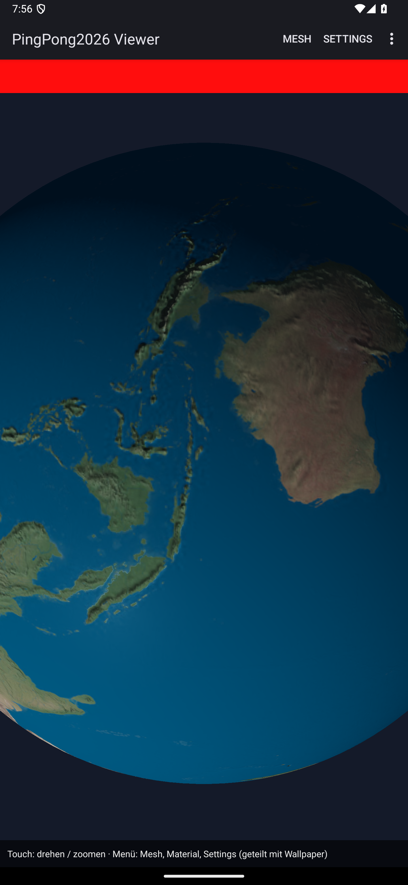](models/earth/shots/) | [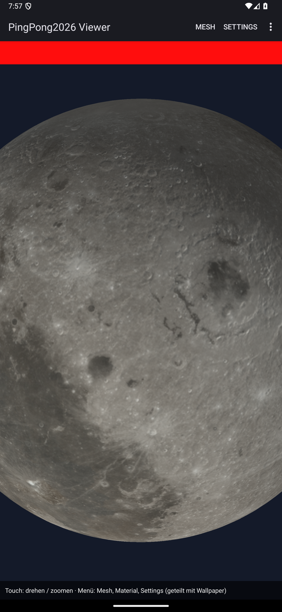](models/moon/shots/) | [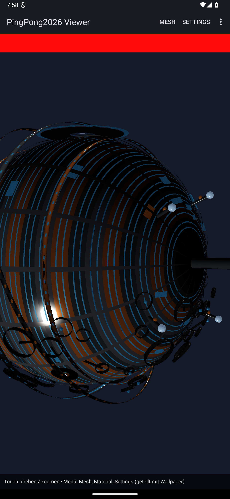](models/scifi-orb/shots/) | [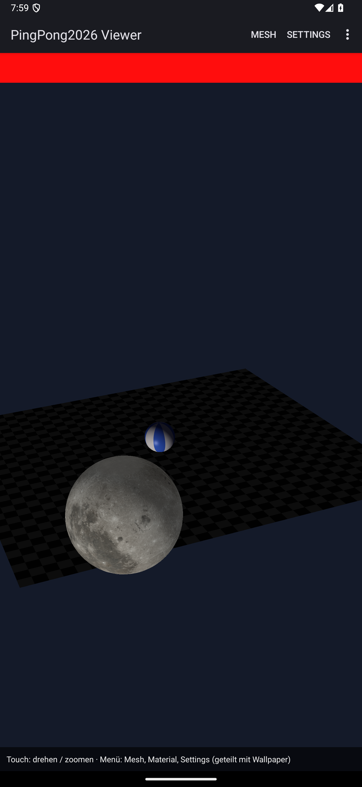](models/clock-sample/shots/) | [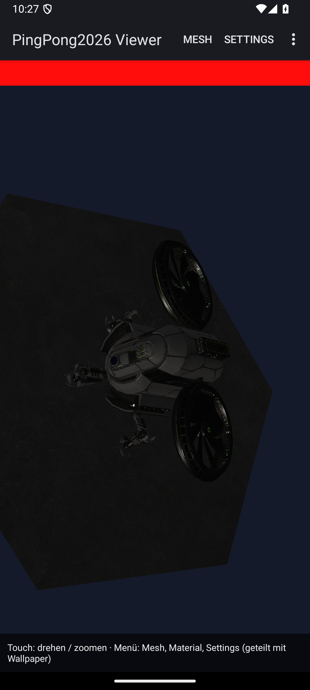](models/buster-drone/shots/) |

Gaussian stills are from **RenderAssimp** desktop Vulkan. Prefer **`02_khronos.png`**
(KHR ellipse / Sample-Viewer-style). **`shots/cheap/*.png`** is the Cheap
(`splatotopoint`) pipe — blockier billboards, **not** reference quality.

#### Khronos pipe (reference look)

| Garden table | MeshInSplats | SplatsInMesh | Rose | Cactus |
|--------------|--------------|--------------|------|--------|
| [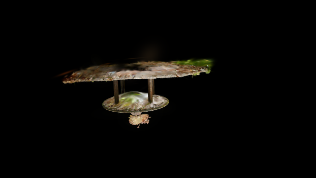](models/gs-garden-table/shots/khronos/) | [](models/gs-mesh-in-splats/shots/khronos/) | [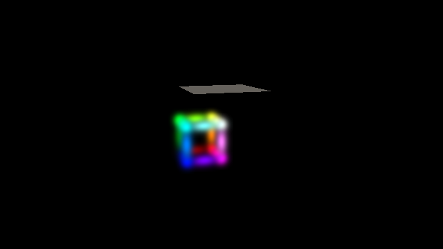](models/gs-splats-in-mesh/shots/khronos/) | [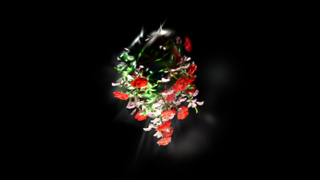](models/gs-rose/shots/khronos/) | [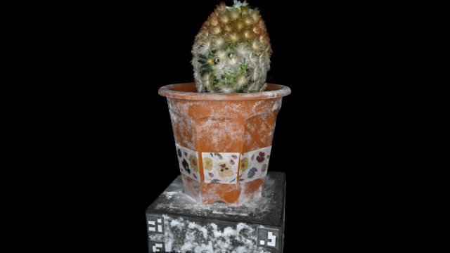](models/gs-cactus/shots/khronos/) |

#### Cheap pipe (comparison)

| Garden table | MeshInSplats | SplatsInMesh | Rose | Cactus |
|--------------|--------------|--------------|------|--------|
| [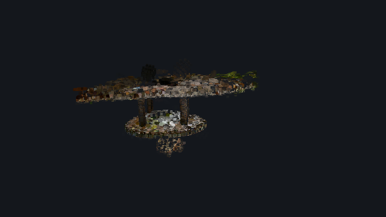](models/gs-garden-table/shots/cheap/) | [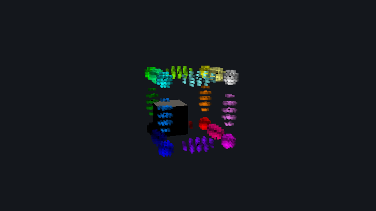](models/gs-mesh-in-splats/shots/cheap/) | [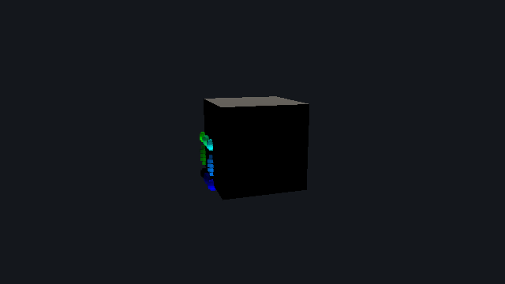](models/gs-splats-in-mesh/shots/cheap/) | [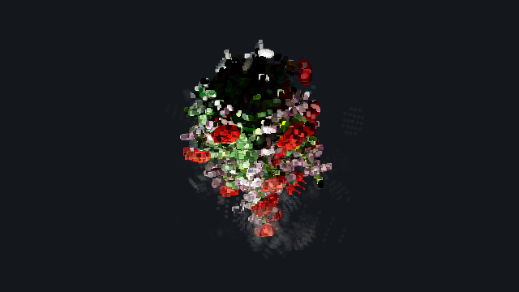](models/gs-rose/shots/cheap/) | [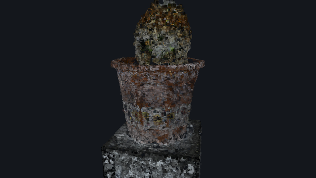](models/gs-cactus/shots/cheap/) |

Each model has **10** emulator screenshots (`shots/01.png`–`10.png`) from the
Vulkan SceneViewer (orbit auto-spin). How they were captured — and that this
pack grew out of an **AI-assisted** Android/Assimp lighting workflow — is under
[How the shots were made](#how-the-shots-were-made).
(Emulator MP4s were dropped: headless `screenrecord` was too janky to keep.)

## Quick start

1. Clone or download this repository.
2. Point your Assimp (or other) loader at e.g. `models/earth/Earth.obj` or
   `models/earth/Earth.3DS`.
3. Keep texture files **next to** the mesh (paths in MTL / 3DS are basenames).
4. Read `models/<name>/INFO.txt` for map meanings and usage tips.
5. **BusterDrone:** fetch `scene.gltf` from Filament (see
   `models/buster-drone/INFO.txt`) — not included here.
6. **Gaussians:** fetch the files named in `models/gs-*/INFO.txt`, then load with
   an Assimp build that exposes `aiGetGaussianSplat`. Prefer raw import for PLY
   so Join does not desync mesh verts from splat counts.

### Recommended load flags (Assimp-style)

- OBJ: enable diffuse + specular + specular-map + bump/height + normals.
- 3DS: same, but expect **generated** mesh normals (no NORMALS chunk); bump /
  height and specular maps are present for Earth, Moon, and ClockSample’s moon.
- glTF (BusterDrone): glTF importer + Draco (or decode first);
  `aiProcess_PreTransformVertices`; metallic-roughness shading (not Blinn-only).
- Gaussian PLY / KHR GLB: Gaussian sidecar API; do **not** invent upright axis
  remaps in Assimp — host may convert RDF→RUB when targeting Y-up viewers.

## How the shots were made

These stills are **not** offline renders. They come from the same Vulkan
SceneViewer used while iterating Earth/Moon specular, sunglint, and normal maps
in an **AI-assisted coding session** (Cursor agent + human review on a headless
Android/NDK host). The goal was a quick, honest look at how the meshes light in
a real Assimp → Vulkan path — the kind of check that showed up repeatedly while
doing that AI-related lighting/asset work.

Short-lived emulator MP4s (`adb screenrecord` + orbit swipes) were recorded the
same way, but they stuttered badly on the headless AVD, so only PNG frames
remain in the repo.

### Pipeline (short)

1. Start AVD `medium_phone` **headless** (`emulator -avd medium_phone -no-audio -no-window`).
2. Install the debug APK of **PingPong2026Assimp** (debuggable so prefs can be
   written via `run-as`).
3. Launch `.SceneViewerActivity` once so `assets/bundled_models/` extract under
   the app’s `files/bundled_models/`.
4. For each model, force-stop the app, write SharedPreferences (`mesh_id=6` +
   `custom_obj_path` → `Earth.obj` / `Moon.obj` / `SciFiOrb.obj` /
   `ClockSample.obj` / `BusterDrone/scene.gltf`, material/map toggles on,
   `camera_engine=orbit`), then start the viewer again.
5. Wait for orbit auto-spin, then capture **10** frames over ~25 s via
   `adb exec-out screencap -p` / `android screen capture` (AVD ~1080×2400).
6. Store as `models/<name>/shots/01.png` … `10.png`.

Helper scripts for start/install/stop on this host live under the parent
workspace skill `emulator-adb-workflow` (not required to use the model files
themselves).

## Licensing

- **Original content** (meshes, authored maps, docs, packaging, screenshot
  PNGs as documentation): [CC0 1.0](LICENSE) — public domain dedication.
- **NASA imagery** (Moon kit, Earth Blue Marble lineage): public domain;
  please credit NASA / GSFC / SVS when practical.
- **three.js** Earth normal map and specular *base*: **MIT** — see
  [ATTRIBUTION.md](ATTRIBUTION.md).
- **BusterDrone** mesh/textures: **CC BY-NC** (not in this repo) — see
  `models/buster-drone/INFO.txt` and [ATTRIBUTION.md](ATTRIBUTION.md).
- **Gaussian samples (link-only):** see each `models/gs-*/INFO.txt` and
  [ATTRIBUTION.md](ATTRIBUTION.md).

## Model notes (short)

**Earth** — Unit sphere with ocean sunglint / polar ice specular authored on
top of a MIT ocean mask; land stays near-matte. See `models/earth/INFO.txt`.

**Moon** — LROC albedo + LOLA-derived bump/normal (radius-matched strength) and
a soft PD-authored regolith specular. See `models/moon/INFO.txt`.

**SciFi orb** — Dense hard-surface orb; metals + emissive accents, no textures.

**ClockSample** — Checker ground, striped clock, moon using the same Moon maps
(copies included under `models/clock-sample/`).

**BusterDrone** — Filament / Sketchfab glTF (PBR, optional Draco). Docs + orbit
stills only here; download the assets from Google’s Filament tree. Animation
not shown in stills. See `models/buster-drone/INFO.txt`.

**gs-garden-table** — URL for Open3D / mip-NeRF 360 garden crop PLY (not shipped);
Cheap + Khronos stills in `shots/`.

**gs-mesh-in-splats / gs-splats-in-mesh** — URLs for javagl KHR mesh+splat GLBs;
Cheap + Khronos stills (docs only).

**gs-rose** — URL / path hint for Rose.ply (not shipped); Cheap + Khronos stills.

**gs-cactus** — URL for CC0 cactus KHR `.glb` / `.ply` ZIP (not shipped);
Cheap + Khronos stills.

## Regenerating Earth / Moon `.3DS`

```bash
python3 tools/obj_to_3ds.py models/earth/Earth.obj -o models/earth/Earth.3DS
python3 tools/obj_to_3ds.py models/moon/Moon.obj   -o models/moon/Moon.3DS
```

(SciFi orb and ClockSample `.3DS` files are pre-built; SciFi exceeds a single
3DS mesh face limit and was exported with mesh splitting.)
